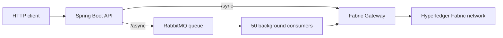

# Synchronous vs. Asynchronous Transaction Processing in Hyperledger Fabric

Source code, JMeter workloads, and experimental results for a comparative study of synchronous and queue-based asynchronous transaction processing in **Hyperledger Fabric**.

The two execution paths use the **same Java chaincode and Fabric network**. In the synchronous path, the HTTP response waits for a Fabric commit result. In the asynchronous path, the API publishes a request to **RabbitMQ** and returns immediately; background consumers subsequently invoke the same blocking Fabric Gateway submission operation. The purpose of the comparison is to distinguish **API responsiveness** from **end-to-end blockchain transaction completion**.

## Repository contents

```text
sync-async-fabric-tx/
├── sync-async-api/           # Java 21 / Spring Boot REST API and RabbitMQ consumers
├── sync-async-chaincode/     # Java chaincode (CREATE, UPDATE, READ)
│   └── README.md             # Chaincode build and deployment instructions
├── tests/
│   ├── createSyncAsset.jmx   # JMeter synchronous CREATE workload
│   └── createAsyncAsset.jmx  # JMeter asynchronous CREATE workload
├── results/                  # Raw JMeter HTTP results (.jtl)
├── LICENSE                   # Apache License 2.0
└── README.md
```

**Data availability:** The `results/` directory in the current repository snapshot contains JMeter **HTTP-level** `.jtl` files. The application-level end-to-end logs used for the research paper are **not yet included in this snapshot**. They should be added to `results/` to make the published end-to-end latency and backlog analysis independently reproducible from the released dataset.

## Processing models



- **Synchronous:** `POST /sync` calls Fabric Gateway `submitTransaction(...)` and responds after the submission/commit-result path completes.
- **Asynchronous:** `POST /async` queues the request, returns a generated asset ID with **HTTP 200** in the current implementation, and leaves Fabric submission to the consumers. **HTTP 200 here means that the API accepted the operation for processing; it is not a ledger commit confirmation.**
- Both submission paths create a unique UUID for each asset. Asynchronous processing uses a durable RabbitMQ queue named `blockchain-queue`, **50 consumers**, and **prefetch = 1**. Each consumer uses the same blocking Gateway `submitTransaction(...)` call; the design does **not** use Fabric Gateway's nonblocking `submitAsync()` API.

The chaincode implements `createAsset`, `updateAsset`, and `readAsset` for an asset with `id`, `name`, `owner`, and `status` (`NEW` or `UPDATED`). The measured JMeter workload uses **CREATE with unique IDs**, avoiding intentional write-write conflicts.

### REST endpoints

| Method | Endpoint | Behavior |
|---|---|---|
| `POST` | `/sync` | Create an asset; wait for the Fabric submission result |
| `PUT` | `/sync?id=<asset-id>` | Update an asset synchronously |
| `GET` | `/sync?id=<asset-id>` | Read an asset |
| `POST` | `/async` | Enqueue asset creation and return its generated ID |
| `PUT` | `/async?id=<asset-id>` | Enqueue an asset update |

Example, with the API running on port `8081`:

```bash
curl -X POST http://localhost:8081/sync \
  -H 'Content-Type: application/json' \
  -d '{"name":"asset","owner":"researcher","status":"NEW"}'

curl -X POST http://localhost:8081/async \
  -H 'Content-Type: application/json' \
  -d '{"name":"asset","owner":"researcher","status":"NEW"}'
```

> This code snapshot does **not** expose a persistent asynchronous status-query endpoint. Asynchronous commit/failure outcomes are recorded in the application log.

## Requirements and local setup

The experimental implementation uses:

| Component | Version / configuration |
|---|---|
| Hyperledger Fabric | 2.5.16, two organizations with one peer each |
| State database | CouchDB 3.4.2 |
| Ordering | etcdraft; `MaxMessageCount = 50`, `BatchTimeout = 500 ms` for the experiments |
| API | Java 21, Spring Boot 3.4.4, Fabric Gateway Java client 1.7.1 |
| Messaging | RabbitMQ (`rabbitmq:3-management`), 50 consumers, prefetch 1 |
| Load generator | Apache JMeter 5.6.2 |
| Experiment host | Ubuntu 24.04, Intel Core i7-8565U (4 cores/8 threads), 16 GB RAM, SSD |

1. **Set up Hyperledger Fabric.** The Fabric binaries, `fabric-samples/test-network`, identity material, and channel configuration are **external prerequisites**; they are not shipped in this repository. Use the guide in [`sync-async-chaincode/README.md`](sync-async-chaincode/README.md) to build/package the Java chaincode, create `sync-async-channel`, and deploy the chaincode under the name `sync-async-chaincode`. Adapt the guide's relative `../fabric/test-network` paths to your local installation. For comparable benchmarking, configure the channel batching parameters listed above **before running the workload**.

2. **Build the chaincode:**

   ```bash
   cd sync-async-chaincode
   mvn clean package
   ```

   The build is configured to produce a Fabric chaincode package in `target/`; follow the chaincode deployment guide for installation and approval on both organizations.

3. **Start RabbitMQ** (example for local development):

   ```bash
   docker run -d --name sync-async-rabbitmq \
     -p 5672:5672 -p 15672:15672 \
     rabbitmq:3-management
   ```

4. **Configure the API.** Update `sync-async-api/src/main/resources/application.properties`, particularly `blockchain.crypto-path`, the certificate/key locations, peer endpoint, and RabbitMQ connection settings. The committed `blockchain.crypto-path` is a machine-specific absolute path and **must be replaced** for your environment. The example RabbitMQ `guest/guest` credentials and disabled authorization are intended **only for a local, isolated test environment**. Do not commit Fabric private keys or production credentials.

5. **Start the API:**

   ```bash
   cd sync-async-api
   mvn spring-boot:run
   ```

   By default, the REST API listens at `http://localhost:8081`.

## Running the JMeter experiments

The supplied `.jmx` files target `localhost:8081`. They are **saved configurations for specific runs**, not five independent preconfigured test plans: `createAsyncAsset.jmx` currently has 50 threads, a 1 s ramp-up, a 60 s duration and a throughput target of 1,200/min; `createSyncAsset.jmx` currently has 400 threads, a 5 s ramp-up, a 60 s duration and a throughput target of 12,000/min.

To reproduce each load level, adjust the **Thread Group** and **Constant Throughput Timer** in JMeter before starting the corresponding run:

| Nominal rate | JMeter threads | Ramp-up | Duration | Timer target |
|---|---:|---:|---:|---:|
| 20 req/s | 50 | 1 s | 60 s | 1,200/min |
| 50 req/s | 100 | 5 s | 60 s | 3,000/min |
| 100 req/s | 200 | 5 s | 60 s | 6,000/min |
| 150 req/s | 300 | 5 s | 60 s | 9,000/min |
| 200 req/s | 400 | 5 s | 60 s | 12,000/min |
| 200 req/s (extended) | 400 | 5 s | 180 s | 12,000/min |

The timer is configured with **all-active-threads shared throughput** (`calcMode = 4`). Run the synchronous and asynchronous scenarios separately, with comparable initial network conditions. Example commands, **after adjusting the plan**:

```bash
jmeter -n -t tests/createSyncAsset.jmx  -l results/my_sync_run.jtl
jmeter -n -t tests/createAsyncAsset.jmx -l results/my_async_run.jtl
```

The performance-test plans issue `POST /sync` or `POST /async` with the same JSON asset payload. The application generates distinct UUIDs server-side.

## Recorded results

The existing `results/` directory contains raw HTTP measurements for nominal rates of 20, 50, 100, 150, and 200 req/s, plus the 180 s asynchronous test. The file names use zero-padded rate labels (`020`, `050`, etc.). The summary below reflects the individual runs reported in the accompanying study; it is **not** a claim of the maximum capacity of Hyperledger Fabric.

| Target req/s | Sync HTTP avg (ms) | Async HTTP avg (ms) | Async end-to-end avg (ms) |
|---:|---:|---:|---:|
| 20 | 398.1 | 3.22 | 345.3 |
| 50 | 397.0 | 2.50 | 351.4 |
| 100 | 357.9 | 7.79 | 492.5 |
| 150 | 298.1 | 3.67 | 304.0 |
| 200 | 351.1 | 9.36 | 2,677.8 |

At the nominal **150 req/s** level, achieved HTTP throughput was approximately **143 req/s**. At **200 req/s for 180 s**, the asynchronous run recorded **35,971 requests**, a mean HTTP response time of **7.46 ms**, and a mean end-to-end completion time of **5,264.9 ms**. The application-level outstanding-operation count peaked at **1,832**. All recorded asynchronous operations in this extended run were logged as successfully completed.

**Measurement interpretation:**

- **HTTP latency** is JMeter's `elapsed` value. For asynchronous requests, this measures the API response, **not** Fabric commit completion.
- **Asynchronous end-to-end latency** is `committedAt - receivedAt`, where the application timestamps the incoming request and records completion after a successful blocking Fabric Gateway submission. These values were extracted from `[TOTAL_TIME]` application log lines. The implementation currently emits the successful status string `COMMITED` (as spelled in the source).
- **Outstanding operations** are reconstructed as cumulative received requests minus cumulative completed requests. This includes both queued and in-flight work and is **not** equivalent to RabbitMQ's queue depth.
- JMeter result files do not contain per-request asset IDs for independently matching HTTP submissions to Fabric commit records. Application-generated completion logs are not a separate ledger audit.

To extract completion records from a new run's application log:

```bash
grep '\[TOTAL_TIME\]' sync-async-api/logs/syncasync-api.log \
  | sed 's/^.*\[TOTAL_TIME\]//' > results/my_async_end_to_end.txt
```

Run the command from the repository root if the API's log path resolves under `sync-async-api/`; adjust the path if the application was launched from another working directory. Capture all commits **after JMeter stops**, including the time needed to drain the queue. The available 50 req/s study log used an older, duration-only format, so not every run provides the same timestamp fields.

## Scope and limitations

This is a research prototype and workload-specific evaluation, **not a production-ready messaging service**. The tests use unique-key CREATE operations, independent 60 s runs, and a single-machine Fabric/JMeter deployment. The synchronous path allows a workload-dependent number of concurrent Fabric submissions, while the asynchronous path has a fixed pool of 50 consumers. The current listener logs failures but does not implement a persistent status API, retry/compensation logic, or independent on-ledger verification of completion records. Throughput and latency should therefore be interpreted in the context of this configuration.

## Related publication

**Manuscript (publication pending)**

R. Miron, M. Hulea, V. Mureșan, and I. V. Sita, **“Performance Evaluation of Synchronous and Asynchronous Transaction Processing in Hyperledger Fabric.”** Prepared for the *International Conference on Electrical and Computer Engineering Researches (ICECER 2026)*.

The **published paper, bibliographic details, and DOI will be linked here when available**. Until then, please refer to this repository for the implementation and the currently shared raw test data.

## License

This project is distributed under the [Apache License 2.0](LICENSE).
